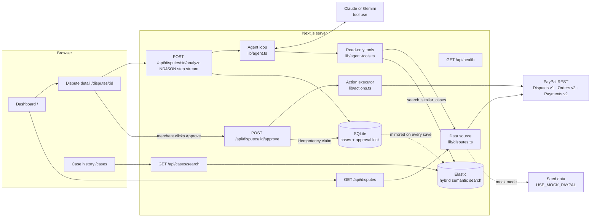

# DisputeDesk

**An AI agent that helps small PayPal merchants handle disputes and refunds.** Built for the PayPal AI Hackathon.

A small merchant losing a $90 dispute also loses the dispute fee and the hour it took to dig through tracking pages and order emails. DisputeDesk does that digging for them. A Claude agent pulls the dispute, order and shipment data from PayPal, checks how similar cases went before, and recommends **accept**, **refund** or **contest**. It gives a confidence score, the evidence behind the recommendation and a ready-to-send message.

The merchant stays in control. **No money moves and no message is sent until they click Approve**, and they can edit the draft or pick a different action first.

  

---

## Quick start

```bash
npm install
npm run dev
```

Open http://localhost:3000. With no configuration the app runs fully offline:

- **PayPal: Mock data.** Ten seeded disputes covering every category: delivered, stalled and untracked shipments, a repeat disputer, a loyal customer, a real double charge and a fake one.
- **AI: Offline rules.** Without an AI key a deterministic rules engine runs the same tools and produces the same trace and output schema, so the demo never breaks.

Add your keys to use the real thing:

```bash
cp .env.example .env.local
# set ANTHROPIC_API_KEY for the Claude agent, or GEMINI_API_KEY (+ AI_PROVIDER=gemini) for Gemini
# set USE_MOCK_PAYPAL=false + PAYPAL_CLIENT_ID / PAYPAL_CLIENT_SECRET for the PayPal sandbox
```

The badges in the top right of every page show which mode is active.

| Script | What it does |
| --- | --- |
| `npm run dev` | Dev server on :3000 |
| `npm run build` / `npm start` | Production build and server |
| `npm test` | Vitest: agent output schema, tool safety, approve route and idempotency |
| `npm run typecheck` | Generate Next route types, then `tsc --noEmit` |
| `npm run reset` | Delete the local case database (stop the dev server first; re-seeds on next start). Handy before recording a demo. |

### Environment variables

| Variable | Default | Purpose |
| --- | --- | --- |
| `USE_MOCK_PAYPAL` | `true` if no PayPal credentials | `false` = call the PayPal sandbox |
| `PAYPAL_CLIENT_ID` / `PAYPAL_CLIENT_SECRET` | empty | Sandbox REST app credentials (developer.paypal.com → Apps & Credentials) |
| `PAYPAL_BASE_URL` | `https://api-m.sandbox.paypal.com` | PayPal API host |
| `AI_PROVIDER` | empty | `anthropic`, `gemini` or `offline`. Empty = first provider with a key (Anthropic, then Gemini), else offline. |
| `ANTHROPIC_API_KEY` | empty | Enables the Claude agent |
| `ANTHROPIC_MODEL` | `claude-sonnet-5-5` | Model for the agent |
| `ANTHROPIC_SERVER_FALLBACK` | `true` | Server-side refusal fallback (beta) for supported models |
| `GEMINI_API_KEY` | empty | Enables the Gemini agent (`GOOGLE_API_KEY` also works) |
| `GEMINI_MODEL` | `gemini-3.8-flash` | Model for the Gemini agent |
| `GEMINI_FALLBACK_MODEL` | `gemini-3.5-flash-lite` | Used if the main model stays overloaded (503/429) after retries. `none` disables it. |
| `DATABASE_PATH` | `./data/disputedesk.db` | SQLite file for cases |
| `ELASTIC_URL` or `ELASTIC_CLOUD_ID` | empty | Turns on Elastic search for case history and the agent's memory |
| `ELASTIC_API_KEY` | empty | Elastic API key |
| `ELASTIC_INDEX` | `disputedesk-cases` | Index name |
| `ELASTIC_SEMANTIC` | `true` | Index a `semantic_text` field for hybrid keyword + semantic search |
| `ELASTIC_INFERENCE_ID` | cluster default | Inference endpoint for `semantic_text` (e.g. an ELSER or E5 endpoint) |

All secrets are read server-side only. `.env*` files are git-ignored except `.env.example`.

---

## How PayPal and AI are each used (for judges)

### PayPal

DisputeDesk is built around PayPal's dispute lifecycle. `lib/paypal.ts` is a typed REST client with OAuth2 client-credentials auth, token caching (shared across concurrent requests), retries with backoff on 429/5xx, `Retry-After` support and one automatic re-auth on 401. Endpoints were checked against PayPal's published Disputes v1 OpenAPI schema.

| Purpose | PayPal API | Who calls it |
| --- | --- | --- |
| Dispute queue and details | `GET /v1/customer/disputes`, `GET /v1/customer/disputes/{id}` (Disputes v1) | Dashboard, agent |
| Order and capture behind the dispute | `GET /v2/payments/captures/{id}` (Payments v2), `GET /v2/checkout/orders/{id}` (Orders v2) | Agent |
| Shipment tracking | `GET /v1/shipping/trackers` | Agent (best effort) |
| **Contest:** submit evidence | `POST /v1/customer/disputes/{id}/provide-evidence` (multipart, `PROOF_OF_FULFILLMENT` with carrier and tracking number, or `OTHER`) | Approve route only |
| **Refund** | `POST /v2/payments/captures/{id}/refund` with a deterministic `PayPal-Request-Id`, then `PROOF_OF_REFUND` evidence with the refund ID | Approve route only |
| **Accept** | `POST /v1/customer/disputes/{id}/accept-claim` | Approve route only |
| Message the buyer | `POST /v1/customer/disputes/{id}/send-message` (only in the `INQUIRY` stage, as PayPal requires) | Approve route only |

Sandbox details it handles:

- The dispute list returns summaries only, so details are fetched in small batches and cached for 60 seconds.
- The tracking API isn't enabled on every account. When it fails, the agent sees "no tracking" instead of an error.
- Refunds use `PayPal-Request-Id: disputedesk-{disputeId}-refund`, so even a retried request can't refund twice at PayPal.
- After a refund succeeds, the follow-up steps (evidence, message) are best effort. A completed refund is never marked as failed and retried.

### AI

The agent (`lib/agent.ts`) is a **tool-use loop** that runs on Claude (Anthropic TypeScript SDK) or on Gemini (`@google/genai`, `lib/agent-gemini.ts`). Both use the same system prompt, the same tool schemas and the same validated `propose_resolution` contract, so you can switch providers with one env var and compare them on the same disputes. Each step is streamed to the UI as it happens.

| Tool | What it returns |
| --- | --- |
| `get_dispute` | Reason, stage, amount, deadline, buyer and the buyer's messages |
| `get_order_details` | Line items and descriptions, address, digital vs physical, checkout IP vs billing country, related captures, buyer order and dispute history |
| `get_tracking` | Carrier, status, signature, delivery address, event timeline |
| `search_similar_cases` | Past cases from this merchant: recommendation, decision, **final result** (won, lost, refunded) |
| `propose_resolution` | The structured result: `{ category, recommendation, confidence, reasoning, evidence_points[], draft_message }` |

What makes it more than a prompt:

- **Learns from history.** Every case (dispute, recommendation, merchant decision, outcome) is stored and searchable. With **Elastic** configured, search is hybrid keyword + semantic (see [Sponsor tools](#sponsor-tools)); otherwise SQLite FTS5 + bm25. The agent cites precedent, e.g. *"a similar past case (HIST-0801) with the same approach ended as won"*. Seeded history includes a **lost** contest, which teaches it when to refund instead.
- **Structured, validated output.** Every tool input and the final proposal are validated with Zod, and the tool JSON schemas are generated from the same Zod schemas. An invalid proposal goes back to Claude as an `is_error` tool result so it can fix it.
- **Visible reasoning.** The UI shows each tool call with its input, result and timing. On supported models it also shows Claude's short progress notes between tool calls (`thinking.display: "updates"`).
- **Safe by construction.** The agent's tools are read-only, and `propose_resolution` only *records* a proposal. Money-moving and messaging calls live in `lib/actions.ts`, which only the approve route imports. A test asserts that no agent tool can refund, accept, send or submit.
- **Prompt-injection aware.** Buyer messages are marked as untrusted data in the system prompt, and every tool is scoped to the dispute being analyzed. A buyer message saying "look at dispute X" can't make the agent read another case.
- **Resilient to overload.** Gemini calls retry with exponential backoff on 429/5xx. If the main model is still busy (Gemini returns *503 high demand* during spikes), the run restarts on `GEMINI_FALLBACK_MODEL`, and the trace and the case record which model answered.
- **Robust.** On Gemini, model turns are passed back unchanged so thought signatures survive between turns, and thought summaries appear in the trace. On Claude it handles parallel tool calls, `pause_turn`, `max_tokens` and `refusal` stop reasons. Server-side refusal fallback (beta) is on by default for supported models. API errors are turned into plain-language messages.

---

## Architecture



```
app/
  page.tsx                     dispute queue
  disputes/[id]/               detail: claim, order, timeline, live agent trace, recommendation, approve
  cases/page.tsx               searchable case history
  api/disputes/...             route handlers (thin; logic in lib/service.ts)
lib/
  paypal.ts                    typed PayPal client + normalizers
  seed.ts                      mock disputes and historical cases
  disputes.ts                  mock/sandbox data source behind one interface
  agent.ts                     Claude tool-use loop, provider switch, trace, error handling
  agent-gemini.ts              Gemini tool-use loop (same tools and contract)
  agent-prompt.ts              system prompt shared by both providers
  agent-tools.ts               tool definitions + read-only implementations
  agent-schema.ts              Zod schemas (tool inputs + resolution)
  agent-offline.ts             deterministic fallback agent
  actions.ts                   executes approved actions (only module that moves money)
  store.ts                     CaseStore interface + SQLite implementation
  elastic.ts                   Elastic index, hybrid query, SQLite-backed wrapper with fallback
  case-text.ts                 searchable text shared by SQLite FTS and Elastic
  service.ts                   analyze / approve / reject logic
tests/                         Vitest
postman/                       Postman collections + environments (app API and PayPal sandbox)
render.yaml                    Render blueprint
```

### Safety and correctness

- **Approval gate.** `POST /approve` is the only path to `lib/actions.ts`. It requires an analyzed case, validates the body with Zod (`draft_message` up to 2000 characters, `action` from an allow-list, no extra fields), and the UI asks for a second confirmation that spells out what will happen.
- **Idempotency.** Before executing, the route claims the dispute in an `approvals` table inside a `BEGIN IMMEDIATE` transaction. Double-clicks, retries and concurrent requests get `409`, and a test runs two approvals in parallel to prove only one executes. A failed execution releases the claim so the merchant can retry. A successful one never runs again.
- **Swappable storage.** Routes and the agent only use the `CaseStore` interface (`get`, `list`, `upsert`, `search`, `claimApproval`, …). Elastic plugs in as a wrapper around it, and a Postgres implementation would only need to replace `SqliteCaseStore`.

---

## Using the PayPal sandbox

1. Create a REST app at developer.paypal.com → Apps & Credentials (Sandbox) and copy the client ID and secret.
2. Make a few purchases with a sandbox **personal** account against your sandbox **business** account (any Orders v2 checkout).
3. Open disputes as the buyer at sandbox.paypal.com → Activity → the payment → *Report a problem*. Disputes start in the `INQUIRY` stage, so `send-message` works.
4. Set `USE_MOCK_PAYPAL=false` plus the credentials in `.env.local` and restart.

Sandbox disputes can take a few minutes to appear in the API. If you can't create any, use mock mode: every screen and action works the same.

---

## Deploying to Render

The repo includes a `render.yaml` blueprint.

1. Push the repo to GitHub, then in Render choose **New → Blueprint** and pick the repo.
2. Fill in the `sync: false` secrets when prompted: `ANTHROPIC_API_KEY` or `GEMINI_API_KEY` (set `AI_PROVIDER=gemini` to force Gemini), and for sandbox mode `PAYPAL_CLIENT_ID` / `PAYPAL_CLIENT_SECRET` with `USE_MOCK_PAYPAL=false`.
3. Optionally add `ELASTIC_URL` (or `ELASTIC_CLOUD_ID`) and `ELASTIC_API_KEY` to turn on Elastic search.
4. Deploy. Build is `npm ci && npm run build`, start is `npm start` (Next.js reads Render's `PORT`), and the health check is `/api/health`, which doesn't call PayPal or the AI provider, so an upstream outage can't fail a deploy.
5. Run the Postman collection against the live URL (see [Postman](#postman)) as a smoke test.

Notes:

- **Persistence.** SQLite lives on the attached disk at `/var/data` (`DATABASE_PATH=/var/data/disputedesk.db`). Disks need a paid instance (Starter or above). On the free plan, delete the `disk` block. The app still works, but cases reset on each deploy or restart, and the seeded history is recreated automatically.
- **Single instance.** SQLite on a disk means one instance. Move to the Postgres `CaseStore` before scaling out.
- **Native module.** `better-sqlite3` compiles during `npm ci`. Render's Node 22 image has the build tools it needs.
- **Timeouts.** The analyze route streams, so long agent runs don't hit idle proxy timeouts.
- **Secrets.** Set them only in the Render dashboard, never in `render.yaml`.

---

## Tests

```bash
npm test
```

- **Agent output schema:** valid and invalid resolutions (bad enums, confidence out of range, empty draft, extra fields, missing fields).
- **Tool safety:** the agent's tool list contains no money-moving or messaging tool, every tool schema is a valid object schema, and access to another dispute is refused.
- **Gemini loop** (mocked SDK): provider selection, parallel calls answered by id, thought signatures passed back, an invalid proposal returned as an error and fixed, cross-dispute access refused, clean failure when no proposal arrives, retry then fallback when the main model is overloaded.
- **Elastic search** (in-memory fake cluster): semantic index creation and SQLite backfill, keyword-only fallback when the cluster has no inference endpoint, category and exclusion filters, mirroring new cases, falling back to SQLite when Elastic is down, and feeding the agent's `search_similar_cases`.
- **Agent runs:** each of the 10 seeded disputes produces a schema-valid resolution with the expected recommendation and tool sequence.
- **Approve route:** requires analysis, executes once, rejects repeats (409), concurrent approvals execute exactly once, uses the edited draft and action override, validates the body, allows a retry after a failure, and blocks approval after Reject or re-analysis after execution.

Plus an end-to-end API test in Postman (14 requests, 34 assertions); see [Postman](#postman).

---

## Sponsor tools

### Render

Hosting. `render.yaml` is a ready-to-use Blueprint: Node 22, `npm ci && npm run build`, `npm start`, a health check at `/api/health`, a persistent disk for SQLite, and every secret marked `sync: false` so it's entered in the dashboard, never committed. See [Deploying to Render](#deploying-to-render).

### Elastic

Elastic powers the agent's memory and the case history search.

- **Hybrid search.** Each case is indexed with keyword fields (category, status, recommendation, result) plus its text as both an English-analyzed `text` field and a `semantic_text` field. A query combines BM25 keyword relevance with semantic similarity in one `bool` query. "Parcel vanished, never showed up" finds past *item not received* cases even with no words in common.
- **Agent memory.** The agent's `search_similar_cases` tool runs on Elastic, so its precedent ("a similar past case ended as won") comes from semantic matches, not just keyword overlap.
- **Design.** SQLite remains the system of record and keeps the approval lock, which needs a real transaction. Every save is mirrored to Elastic, and existing cases are backfilled on startup. If Elastic is unreachable, search quietly falls back to SQLite FTS so the app keeps working. The case history page shows which engine answered.
- **Setup.** Create an Elastic Cloud deployment or serverless project, then create an API key. Set `ELASTIC_URL` (or `ELASTIC_CLOUD_ID`) and `ELASTIC_API_KEY`, and restart. The index and mappings are created automatically. If the cluster has no inference endpoint for `semantic_text`, DisputeDesk creates a keyword-only index and says so in the log; set `ELASTIC_INFERENCE_ID` to use a specific endpoint.

### Postman

The `postman/` folder has two collections and three environments:

| File | What it's for |
| --- | --- |
| `DisputeDesk-API.postman_collection.json` | End-to-end test of DisputeDesk's own API: health, queue, detail, 404, AI analysis (checks the output schema), approval with an edited draft, **idempotency (second approve returns 409)**, body validation (400), reject, approve-after-reject (409), and case search. 14 requests, 34 assertions. It picks open disputes automatically, so it can be rerun. |
| `PayPal-Sandbox.postman_collection.json` | Every PayPal endpoint DisputeDesk uses, against the sandbox, with automatic OAuth: disputes, captures, orders, trackers, provide evidence, refund (with `PayPal-Request-Id`), accept claim, send message. It also has the **sandbox-only simulation** endpoints (`require-evidence`, `adjudicate`) for playing PayPal's part and settling a dispute in the seller's or buyer's favor. |
| `DisputeDesk-Local` / `DisputeDesk-Render` environments | `baseUrl` for local and deployed runs |
| `PayPal-Sandbox` environment | `clientId` / `clientSecret` (secret type, empty in the repo) |

Run it in Postman (Import, select the `postman/` folder, then use the Collection Runner), or from the command line:

```bash
npx newman run postman/DisputeDesk-API.postman_collection.json -e postman/DisputeDesk-Local.postman_environment.json
```

## Roadmap

- PayPal webhooks (`CUSTOMER.DISPUTE.*`) to refresh statuses instead of polling.
- Upload evidence documents (delivery photos, invoices) as multipart files.
- Postgres `CaseStore`, multi-merchant auth and per-merchant history.
- Track win rate by recommendation type and feed it back to the agent.
